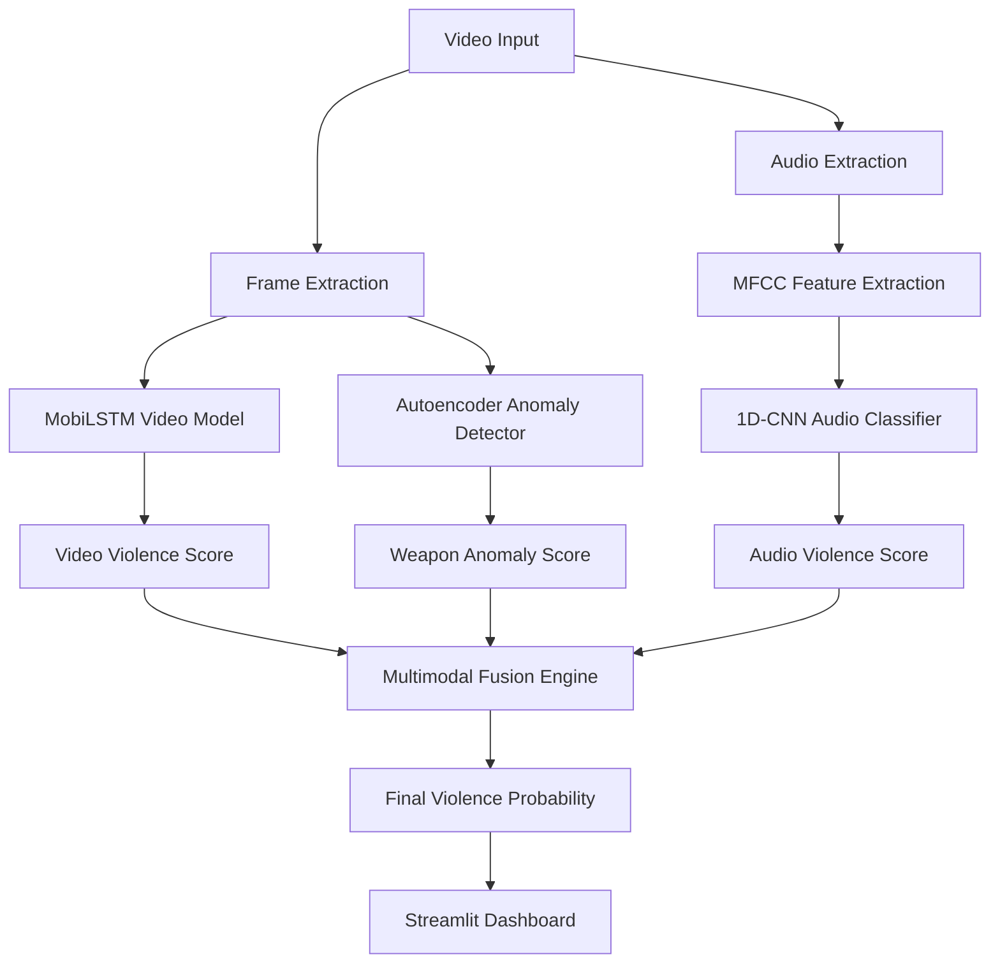

<div align="center">

# 🔥 VigilAI

### Real-Time Multimodal Violence Detection using Video, Audio, and Anomaly Fusion

**A deep learning–powered system that detects violent activities by analyzing video motion patterns, audio distress signals, and weapon anomalies simultaneously.**
*Combining MobiLSTM video modeling, 1D-CNN audio classification, and autoencoder-based anomaly detection in a unified multimodal AI pipeline.*

<br>

[](https://www.python.org/)
[](https://tensorflow.org/)
[](https://streamlit.io/)
[](https://opencv.org/)
[](https://librosa.org/)
[]()

</div>

---

> **Project status:** Experimental detection system, not a definitive violence detector. Audio/video models can miss events or flag harmless activity; use human review, privacy safeguards, and applicable legal/ethical controls before any real-world monitoring.


# 📖 What is VigilAI?

VigilAI is a **multimodal deep learning system designed for real-time violence detection** using multiple complementary signals.

Traditional surveillance systems rely primarily on **visual cues**, which can fail under challenging conditions such as poor lighting, occlusion, or low-resolution footage.

VigilAI addresses these challenges by simultaneously analyzing:

* **Video motion patterns**
* **Audio signals**
* **Weapon anomalies**

The system combines outputs from three specialized neural models through a **multimodal late fusion framework**, producing a robust violence probability score suitable for **real-time surveillance and security monitoring**.

---

# ✨ Features

| Feature                         | Description                                       |
| ------------------------------- | ------------------------------------------------- |
| 🎥 **Video Violence Detection** | Detects aggressive motion patterns using MobiLSTM |
| 🔊 **Audio Violence Detection** | Detects screams, impacts, and weapon sounds       |
| 🗡 **Weapon Anomaly Detection** | Autoencoder detects potential weapons             |
| ⚡ **Multimodal Late Fusion**    | Combines video, audio, and anomaly signals        |
| 📊 **Real-Time Visualization**  | Interactive Streamlit dashboard                   |
| 🎛 **Frame-Level Analysis**     | View predictions per frame                        |
| 📈 **Confidence Graphs**        | Displays probability and anomaly scores           |

---

# 🏗️ System Architecture



---

# 🛠️ Technology Stack

### Core AI Models

| Component        | Technology                        |
| ---------------- | --------------------------------- |
| Video Classifier | `MobileNetV2 + LSTM` (MobiLSTM)   |
| Audio Classifier | `1D Convolutional Neural Network` |
| Weapon Detection | `Convolutional Autoencoder`       |
| Fusion Model     | Weighted Late Fusion              |

---

### Libraries

| Component           | Technology         |
| ------------------- | ------------------ |
| Deep Learning       | TensorFlow / Keras |
| Video Processing    | OpenCV             |
| Audio Processing    | Librosa            |
| Numerical Computing | NumPy              |
| Visualization       | Matplotlib         |
| UI Framework        | Streamlit          |

---

# 📂 Project Structure

```text id="ll6h4m"
Realtime-Multimodal-Violence-Detection/
│
├── main.py                 # Streamlit dashboard + inference pipeline
├── utils.py                # Preprocessing & feature extraction utilities
│
├── models/
│   ├── mobilstm_model.h5
│   ├── audio_cnn_model.h5
│   └── autoencoder_model.h5
│
├── requirements.txt
└── README.md
```

---

# 🚀 Installation & Setup

### Prerequisites

* Python 3.10+
* pip

---

# 1️⃣ Clone Repository

```bash id="i7spmt"
git clone https://github.com/kishorekrrish3/Realtime-Multimodal-Violence-Detection.git
cd Realtime-Multimodal-Violence-Detection
```

---

# 2️⃣ Install Dependencies

```bash id="ptj98y"
pip install -r requirements.txt
```

---

# 3️⃣ Run Streamlit App

```bash id="2mlnbj"
streamlit run main.py
```

---

# 🌐 Application Interface

Open in browser:

```id="t1hm3g"
http://localhost:8501
```

---

# ⚙️ How It Works

The system processes **three independent modalities**.

---

### 🎥 Video Violence Detection (MobiLSTM)

Pipeline:

1. Extract frames from video
2. Use **MobileNetV2** for spatial feature extraction
3. Feed features into **LSTM layers** for temporal pattern modeling
4. Predict violence probability

Detects:

* punching
* fighting
* aggressive motion

---

### 🔊 Audio Violence Detection (1D-CNN)

Audio pipeline:

1. Extract audio track
2. Convert into **MFCC features**
3. Pass features through **1D-CNN classifier**

Detects:

* screams
* distress signals
* weapon sounds
* loud impact noises

---

### 🗡 Weapon Detection (Autoencoder)

The autoencoder:

* learns patterns of **normal frames**
* reconstructs frames during inference
* measures **reconstruction error**

High error → possible weapon anomaly.

Detects:

* knives
* guns
* metallic weapon-like shapes

---

# ⚖️ Multimodal Fusion

Final prediction is computed using weighted fusion:

```text id="fr36q6"
FinalScore = w1 * VideoScore + w2 * AudioScore + w3 * WeaponAnomalyScore
```

Benefits:

* improves robustness
* reduces false positives
* compensates for missing signals

---

# 📊 Dashboard Features

The Streamlit UI provides:

* Video upload interface
* Audio waveform visualization
* Frame-level predictions
* Reconstruction error graphs
* Violence probability timeline
* Spectrogram visualizations

---

# 📈 Example Outputs

Possible outputs include:

* Violence probability curves
* Audio spectrograms
* Frame anomaly heatmaps
* Reconstruction comparisons

---

# 🧠 Why Multimodal Detection?

Real-world violence scenarios are complex.

Single-modality detection often fails due to:

* occlusion
* poor lighting
* silent attacks
* audio-only incidents

Multimodal AI improves detection by combining complementary signals.

---

# 🔮 Future Enhancements

* YOLO-based weapon detection
* Transformer-based audio-visual fusion
* Edge deployment on NVIDIA Jetson
* Multi-camera CCTV monitoring
* Real-time alert system with notifications

---

# 👨‍💻 Author

**Kishore P**
AI & Full Stack Developer
CSE (AI & Robotics) — VIT Chennai

---

<div align="center">

<br>

<i>Enhancing public safety with multimodal artificial intelligence.</i>

<br><br>

**VigilAI** — intelligent violence detection for modern surveillance.

</div>
